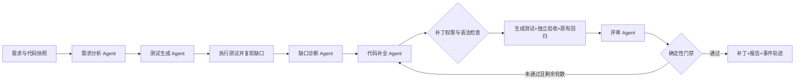

# TestFix-Agent

本仓库仅发布项目源码和示例；本地任务数据、模型凭据、实验运行记录及用户上传文件不包含在仓库中。WCTP 源码需要自行取得授权，并通过 `TESTFIX_WCTP_ROOT` 配置；相关第三方组件说明见 [THIRD_PARTY_NOTICES.md](THIRD_PARTY_NOTICES.md)。

项目定位：**无遁 Fix Agent：面向工程的多智能体协同开发补全与自动化测试平台**。总体方向包括需求澄清、工程开发与修改、故障补全和可编辑自动化测试；现有工程适配范围、硬件接口及云端能力以各功能的实际验证为准。

**参赛方向**：第十一届华为 ICT 大赛创新赛赛题一「基于华为云产品打造 AI 创新应用」。当前本地补全与自动化测试已有实测，CodeArts 实际开发使用、华为云部署与在线演示仍待完成；赛题细则以组委会正式材料为准。

**论文实验入口**：`testfix study` 可对已登记工程冻结任务与预算，并批量运行不同模型槽位配置；研究运行的独立验收只执行一次。配置、实际步骤和目前的评测限制见 [论文实验流程](docs/paper-study.md)。

**描述功能直接测试**：在“工程协作 → 自动化测试”输入想测试的行为和预期，选择原始工程或已补全版本。独立测试 Skill 分析功能、生成测试步骤，再用原 WCTP 连线与循环执行；保留逐项结果和历史。任务管理系统 TaskBoard 还支持逐操作 HTTP 步骤和人工审核。使用方法及适配边界见 [功能描述自动测试](docs/feature-testing.md)。

**最新自动化测试入口**：桌面“工程协作 → 自动化测试”。测试现在实际采用用户提供的 WCTP 原生步骤、分叉汇聚与循环执行，提供连线图、AI 测试步骤、逐用例结果和固定版本循环重测。最新完整运行 `4172354a` 和三轮重测 `aacfc415`、闪烁修复及验证证据见 [WCTP 自动化测试](docs/wctp-automation.md)。

架构已按 **CodeAgent 主控 → 专业员工生成与补全 → 自动化测试** 分层。主控的 CP-SAT 联合选择任务、员工实例和策略，工具批次结束后重新求解；默认支持 32 项任务，可配置任务图上限。三维视图按模块查看，流程能力、员工、算法与执行底座分别显示。机制与本轮真实验证见 [工程架构](docs/completion-architecture.md)。

执行与验证现支持 [实时三维 Agent 协作视图](docs/agent-live-flow.md)：查看主控派工、问题分析、员工工具与补丁回传，支持旋转缩放、节点详情和历史回放。画面沿用真实运行事件；回放不会启动新的模型任务。

Windows 桌面工程版：双击 `dist/desktop/0.1.4/Wudun-TestFix-win32-x64/Wudun-TestFix.exe` 或桌面“无遁 TestFix”快捷方式，即可自动启动引擎和三维界面。依赖当前工程及其虚拟环境，支持空闲端口、引擎恢复和任务后台保留，见 [桌面软件使用与构建](docs/desktop-app.md)。

任务输入入口：在“工程协作”选择“创建任务 / 导入工程”，或在“全部功能”选择“创建任务”（`/intake`）。支持安装包、ZIP / TAR 源码包与附件上传，GitHub 仓库 / 公网下载网址读取，以及直接描述新功能；可填写验收标准与运行环境。原文件、SHA-256、需求原文、识别结果及事件记录保存在 `artifacts/intakes/<task-id>/`，重启后可查看并下载原文件和交接单。单文件上限 1 GB、每任务 20 个附件。

**任务中心（`/tasks`）**：集中浏览全部输入任务，按名称、需求、附件搜索，按状态/来源筛选，分页查看。点击任务可编辑资料、下载原始附件、查看处理记录与 AI 整理记录。保存使用资料版本校验，避免旧页面覆盖新资料；“已整理”仅表示材料已识别，后续补全和测试仍以真实执行记录为准。

**自己填写 / AI 生成**：创建任务和详情页均可选择。AI 模式通过已有真实模型配置，使用 `testfix/intake_skills/task-details/SKILL.md` 整理名称、功能描述、验收标准和运行环境，并列出假设与待确认项。已有工程任务可读取受限的 README/清单摘录；未保存附件只传文件名。生成结果先展示为草稿，点击“采用草稿并填入表单”后可继续编辑，最终保存才生效。无可用模型或请求失败时明确报错，不回退为伪造的生成结果。请求的模型、服务报告的实际模型（可能未报告）、用量、Skill 哈希和草稿保存在 `artifacts/intake-proposals/<proposal-id>/proposal.json`。默认沿用已登录 Codex CLI 的 `gpt-5.6-sol` 配置，亦可选择已配置的兼容 API、Ollama 或 AgentArts 合同端点。

**补全与修改（`/implementation`）**：从任务中心进入，选择项目、明确功能、开始修改，再查看实际测试步骤、任务分工、代码差异和验证报告。桌面“工程协作”默认进入这一简洁页面，节点图保留在 `/engineering/flow`。任务管理系统的上传源码现可登记到独立执行副本，使用真实模型、多 Agent 和原有九能力流程修复搜索、分页与 SQLite 完成状态保存；原始附件与已有测试保持不变。通过验收后可以下载完整工程并启动真实程序。其他已登记的 Flaskr、rich-cli 工程沿用各自执行适配器；任意未知仓库和安装包仍需要匹配的执行适配器，不能把“材料已整理”当成“工程已补全”。

2026-10-26 上传任务管理系统实测：原有回归 **6/6**、模型生成测试 **10/10**、独立验收 **12/12**、实际 HTTP/SQLite 重启及 20 轮循环检查 **37/37**。运行 `4fd96e53eb754b93b4bf917bb835329e`，最终差异仅为 `taskboard/storage.py`。此前一次员工分工适配失败的记录保留为 `1cccaba6d5a24220bb53da385f7e2ad0`；修正适配后复用其中 5 项已完成的公开分析，新增 11 次真实模型调用完成修复和评审，复用不计作新推理。详见 [本轮执行记录](docs/taskboard-implementation.md)。

面向软件缺失功能的多 Agent 自动化测试与代码补全工程。输入公开需求和 Python 源码，系统分析功能缺口，生成并执行测试，根据失败证据提出补丁，通过独立验收与原有回归后输出代码差异、候选文件和报告。

当前覆盖 **Python 单模块功能补全**、**完整 Flaskr Web 工程的自主跨文件补全**和 **rich-cli 完整 Python 命令行工程修复**。函数任务支持 GitHub HumanEval 和本地任务清单；完整工程已连接真实 OR-Tools CP-SAT、八个模型能力与第九项确定性验证，采用独立 pytest、wheel 构建及真实 HTTP 或 CLI 验证。任意仓库自动安装依赖、通用多语言工程处理和完整 WCTP 设备接入仍需扩展。

自然语言需求协作入口已接入 CLI 和 API：总控分析需求，生成带依赖的员工任务图；员工在 Skill 和文件权限内读取、搜索、运行公开测试、提交补丁；失败反馈进入下一轮总控重新分配，最终仍通过独立验收。现通过真实 WCTP 图执行器并行调用员工模型，默认两个模型槽位，采用出度优先派工和按文件冲突控制的宿主提交。使用方法和适配边界见 [总控与员工协作](docs/requirements-team.md)、[WCTP 并行与出度优先](docs/wctp-parallel.md)，相关论文与开源实现见 [工程修复研究参考](docs/repair-research.md)。不需要打开展示网页。

2026-10-24多树实测：3个隔离候选通过公开检查，选定候选完成21项生成测试、24项原回归、20项独立验收与40项HTTP/重启检查。失败记录、复用来源和原始证据见 [本轮实测报告](docs/search-experiment-20261024.md)。

员工按源码信号加载软件、前端、后端、数据库等专业 Skill，并记录无需加载和缺适配器的专业。新增十份专业 Skill 的边界与分工预览见 [专业 Agent 路由](docs/specialist-routing.md)。现在可用隔离候选工作区、UCT 单树/多树搜索、公开测试反馈和一次最终独立验收；节点连线工作台位于 `/engineering`，机制与实验口径见 [可执行 MCTS 工程补全](docs/mcts-engineering.md)。这不等于已支持任意 JavaScript 工程或 MCU/MPU 固件的自动修复。

GitHub 真实缺陷实验：Textualize/rich-cli 的 CSV 字面值丢失与异常退出，固定版本、独立评测及实际模型调用记录见 [rich-cli 实验说明](experiments/rich-cli/README.md)。准备并重新运行：

```powershell
.\scripts\setup-richcli.ps1
.venv/Scripts/python.exe -X utf8 -m testfix.cli complete-project --project Project/rich-cli --provider codex_cli --model gpt-5.6-sol --max-rounds 2 --wall-seconds 5400 --token-limit 900000
```

此命令发起新模型调用。Python 包适配器默认时间预算 5400 秒；Flaskr 默认仍为 4500 秒。原始源码、生成测试、上游测试、自建冻结回归与独立验收分别保存。测试及 CLI 子进程固定 UTF-8、200×60 终端视口；CLI 从本次构建的 wheel 执行。

## 完整工程补全

完整工程 API 和 `complete-project` CLI 会从注册工程的原始源码创建新快照，自主执行规划、探索、定位、需求分析、测试生成、诊断、补丁、评审和独立验收。线性模式在公开测试失败、拒审或独立验收失败后反馈并有限修复；搜索模式只用公开反馈扩展候选，选定后进行一次最终独立验收。修改后必须重新评审当前源码哈希。默认复用本机 Codex CLI 的 ChatGPT OAuth 登录态，请求 `gpt-5.6-sol`，不需要为该入口另配 API Key。

完成下文主环境及 `.venv-flaskr` 初始化后执行：

```powershell
codex login status
# 发起新的模型推理和完整工程验证
.venv/Scripts/python.exe -m testfix.cli complete-project --project Project/flaskr --provider codex_cli --model gpt-5.6-sol --max-rounds 2 --wall-seconds 4500 --token-limit 800000 --strategy balanced
```

默认预算为 **4500 秒 / 800000 token**，修复两轮，可配置 1–5 轮。单能力调用上限均为五次，产物校验纠正也消耗额度；120/180/240 秒单次合同超时和剩余总预算同时约束执行。整数求解采用配置的累计时长与 token 预测；实际账本按 provider 报告记入，缺失用量使用预留值并明确标注。CLI 输出 token cap 是提示词软约束，无法保证服务端硬截断；token 报告不等于独立核验的账单费用。

声明时长同时计入公开测试工具，默认两轮为 **4410 秒 / 73.5 分钟**，不是只相加模型超时。测试和补丁先整组预检、再写入；裸文件名、语法、范围或版本错误反馈后有限纠正，不放宽保护约束。已保留的真实运行失败及后续新运行证据见 [实测记录](docs/autonomous-engineering.md#本次真实运行记录)。

注册 Flaskr 的固定关卡包括原有 **24 项回归**、独立 **20 项验收**、wheel 构建与 **40 项真实 HTTP 检查**，其中包含 SQLite 跨进程重启。生成用例数以本次实际收集结果为准。独立验收源码不进入模型上下文，原始文件与冻结测试受哈希保护，补丁和评审均绑定实际候选版本。求解状态 `OPTIMAL` 仅针对声明目标，不能代替工程验收。

每次新运行的证据保存在 `artifacts/<run-id>/report.json`、`capabilities/`、`model_calls/` 与工具日志中；只有最终通过才生成 `completed-project.zip`。完整配置、九能力执行链和边界见 [自主工程说明](docs/autonomous-engineering.md)、[整数模型](docs/ilp-model.md)。

本次新自主运行 `1a500f9521c141168613504e1c57d352` 已完成：九能力均为 `completed`，一轮补丁通过，实际耗时 **441.452 秒**。八次真实 Codex CLI 请求均指定 `gpt-5.6-sol`；服务未回报实际模型名，八次 `actual_model` 均为 `null`，证据标记为 `requested_cli_flag_only`。provider 报告 token 合计 **198161**，不作为账单费用证明。

| 本次验证 | 原始工程 | 最终候选 |
| --- | --- | --- |
| 本次模型生成测试 | 0/10 | 10/10 |
| 原有回归 | 24/24 | 24/24 |
| 独立验收 | 0/20 | 20/20 |
| wheel 构建 | — | 1/1 |
| 真实 HTTP，含 SQLite 重启 | — | 40/40 |

报告为 `artifacts/1a500f9521c141168613504e1c57d352/report.json`；交付包为同目录 `completed-project.zip`。候选哈希与评审一致、全部 verdict 为真，归档 SHA-256 已复核；完整哈希与保留的失败记录见 [实测记录](docs/autonomous-engineering.md#本次真实运行记录)。这是该 Flaskr 合同的一次真实执行证据，不代表任意工程或全部输入的正确性。

## 历史完整工程候选复验

`experiments/flaskr/` 保存 Pallets 官方 Flaskr 微型博客的原始与补全后工程，包含注册、登录、SQLite、文章增删改、Jinja 页面及原有测试。
补全需求来自官方后续开发说明：**文章详情、标题搜索、每页五篇分页**；原工程没有被人为破坏。
GPT-5.6 Sol 在会话中生成工程测试、实际修改路由/模板/CSS，并独立评审；监督者运行不向补全 Agent 提供源码的验收测试。

```powershell
# 准备完整工程独立环境
.\scripts\setup-project.ps1
# 重新执行已保存候选的六组测试、构建与真实 HTTP 验证
.venv/Scripts/python.exe -m testfix.cli evaluate-project experiments/flaskr/manifest.json
# 启动补全前/后的真实应用；保留演示数据库
.\scripts\start-flaskr.ps1
# 停止本工程管理的两个 Flaskr 服务
.\scripts\start-flaskr.ps1 -Stop
```

补全后应用：http://127.0.0.1:8766/ ，原始对照：http://127.0.0.1:8767/ 。
演示用户 `demo` 的本地示例密码为 `only-local-demo`；也可自行注册。
详细合同、公开模型输入输出、修改差异、逐用例身份及独立验证证据见 `experiments/flaskr/README.md` 和运行报告。
这份历史会话实验的模型生成与本地评测分阶段进行，不能将其追认为新增自主运行的结果。新的自主入口仍在本机执行已检查的 Flaskr 源码；两种结果都不是 AgentArts 云端部署证据。

## 本地运行

本机入口：http://127.0.0.1:8765 。后台服务使用 `scripts/start.ps1 -Background` 启动，日志和 PID 位于 `artifacts/service/`。

**3D 流程实验室：http://127.0.0.1:8765/lab**。可以选择已注册工程并发起真实模型运行，查看总控、员工依赖、当前 Skill 合同、真实工具回执、测试前后结果和补丁；已完成 rich-cli 运行还可以输入自己的 CSV，分别执行原版和交付 wheel。默认展示标明运行 ID 的历史记录，手动探针不改变原验收成绩。WebGL 不可用时自动使用可交互的平面视图。

**SQLGlot 3D 功能补全工作台：http://127.0.0.1:8765/fea**。Three.js / WebGL 主场景支持旋转、缩放、点选和聚焦九项能力，侧栏展示真实产物，底部面板展示测试设计、代码补丁和现场操作。可输入有限的 SQL 构建参数，真实对比原版、首个失败候选和最终安装包，也可重新执行 9 项生成测试与 140 项原项目回归。页面回看历史 LLM 记录；探针与重测按钮只执行本地 Python，不发起新模型调用。需要本机已保存的实验产物。

**MPU / MCU 硬件测试：http://127.0.0.1:8765/hardware**。支持用户声明的 HTTP、SSH 和串口文本/十六进制协议，不限定芯片型号。CodeAgent 通过专用 Skill 编排动作，宿主执行固定响应合同，分别展示通信与功能结果。安装可选依赖 `uv sync --extra dev --extra hardware`；设备协议、回环演示及结果口径见 [硬件测试指南](docs/hardware-testing.md)。

硬件工作台采用 React、TypeScript、Radix UI、React Flow 和 CodeMirror 6。首次启动或修改前端后，进入 `frontend` 执行 `pnpm install --frozen-lockfile`、`pnpm build`，再启动 Python 服务。开发、构建、许可证和结果展示说明见 [前端工作台指南](docs/frontend-workbench.md)。

**大型工程数据集**：网页、桌面/工具软件、MCU、MPU 四类，分别评测受控缺陷修复与用户需求实现。工程清单、三态制备工具、固定版本及真实准备状态见 [大型工程数据集](docs/large-project-dataset.md)。候选数量不代表已修复成绩。

**产品级测试**：冻结多数据与独立预期，对固定候选执行可复现循环，保留首失败和全部轮次；功能、回归、数据一致性、稳定性、并发、性能、恢复、安全、兼容与交付分别核验。已测 scope 通过不等于产品合格，当前本机 HTTP 短循环不代表四类大型工程已完成验收。命令行入口、证据与限制见 [产品级测试](docs/product-testing.md)。

**双 Web 实时实验：http://127.0.0.1:8765/web-testing**。跟踪 Uptime Kuma 与 Paperless-ngx 的完整源码、环境、受控缺陷、真实模型补丁、构建与循环浏览器验证。实际就绪后提供独立原版/候选应用入口；安全策略禁止嵌入时使用独立标签。各自当前阶段与未执行项在页面实时显示，实验方法与证据见 [网页系统补全实验](experiments/web-live/README.md)。

操作见 [实验室指南](docs/visual-lab.md)，参赛演示安排与待核验规则见 [演示与验收说明](docs/contest-demo-playbook.md)。SWE-bench Lite 300 项、BugsInPy 501 项已采集并校验版本和哈希，当前仍待运行环境和执行适配，不能计入修复成绩；来源、任务预览和后续实验设计见 [基准数据说明](docs/benchmark-datasets.md)。

```powershell
# 在项目根目录运行；需要 Python >=3.11 和 uv
.\scripts\bootstrap.ps1
.\scripts\start.ps1 -Background
# 停止本工程管理的服务
.\scripts\stop.ps1
```

也可前台运行 `.\scripts\start.ps1`。`bootstrap.ps1` 安装 `uv.lock` 锁定的核心依赖，下载固定 GitHub 数据版本、导入订单模块样例，并调用 `setup-project.ps1` 准备完整工程验证环境，不修改你的旧 WCTP 工程或导入的原项目。

`setup-project.ps1` 默认以 Python 3.13 创建/复用 `.venv-flaskr`，安装 `experiments/flaskr/requirements.lock` 中 20 项固定版本依赖，再检查 Flask、pytest 与 build 可导入。它不把旧 `experiments/flaskr/candidate` 以 `-e` 安装进环境。pytest worker 将导入绑定到本次工作区的 baseline/candidate，交付 HTTP 则从本次构建的 wheel 启动；需要重建依赖时可单独重跑该脚本。

```powershell
# 可复现的六任务流程验证
.\.venv\Scripts\python.exe -m testfix.cli run --provider replay --tasks HumanEval/0 HumanEval/1 HumanEval/2 HumanEval/3 HumanEval/4 Repo/order-discount
# 执行工程验证测试。使用新目录可绕开本机已有 TEMP pytest 目录的权限问题。
.\.venv\Scripts\python.exe -m pytest -q --basetemp artifacts/pytest-local
```

`replay` 使用独立手写的测试与补丁，未读取官方参考答案。**回放通过仅证明流程、执行器与门禁可复现，不代表真实大模型补全成绩。** 真实模型不可用时会明确失败，绝不自动回退为回放答案。

## v0.2.0 分发与源码包

完整控制台、注册 Flaskr fixture、锁定环境脚本和实验文件随源码包提供。打包入口为 `scripts/package_source.py`：

```powershell
.venv/Scripts/python.exe scripts/package_source.py
```

输出 `artifacts/release-v0.2.0/testfix-agent-v0.2.0-source.zip` 及对应 `.manifest.json`。ZIP 内含 `SOURCE-MANIFEST.json` 的逐文件 SHA-256；解压后在源码根目录运行 `scripts/bootstrap.ps1` 和 `scripts/start.ps1`。

v0.2.0 wheel 交付核心 Python 库和 Skill 目录。完整 `web/`、`experiments/` fixture 与 setup 脚本需要源码树或上述源码 ZIP；不能仅安装核心 wheel 就宣称可以独立运行完整 `serve` 控制台与 Flaskr 自主流程。

## GPT-5.6 本次真实生成实验

已通过 Codex 的 `gpt-5.6-sol` 子 Agent，根据 HumanEval/10、/13、/20 的公开功能描述生成36条测试、缺口诊断、三个完整补丁及独立评审。模型生成与本地评测分开：结果来源是本次实际模型会话，本地运行器读取保存的输出验证，没有调用未配置的API，也没有把旧replay补丁当新结果。

```powershell
# 重复验证已保存的会话输出；这条命令不会发起新的模型生成。
.\.venv\Scripts\python.exe -m testfix.cli evaluate-session experiments/gpt56/bundle.json
```

完整记录位于 `experiments/gpt56/`，包含公开输入、测试步骤/覆盖映射、模型原始输出、失败复现、评审代码哈希和评测侧性质检查。接口拒绝缺失角色、输出篡改、输入指纹不符、旧代码评审与额外验证缺失；模型新一轮修复必须重新采集输出，不能伪装重复读取为新推理。

当前三个任务均通过36条开发测试、三个官方独立验收套件、六条原有回归及2432个额外输入检查。性质检查范围是：回文的二字符字母表长度0–7；GCD非负整数0–32（排除0,0）；最近数值对取三种有限数值、长度2–6。生成用例另覆盖Unicode、负整数、浮点小数等；结果仅对已声明范围作实证判断。

网页历史将此类结果标为“GPT-5.6会话生成 · 本地评测”，其耗时是执行阶段，模型生成时间保存在来源记录中。新增完整工程自主运行可使用已登录 Codex CLI，也可选择另行配置的真实模型服务；AgentArts 云环境尚未接通。

## 多 Agent 流程

下图保留函数任务的执行流程；完整工程九能力执行链见 [自主工程说明](docs/autonomous-engineering.md)。



函数任务的角色使用独立提示词、JSON 输出结构与上下文，由自有状态机监督编排。验收裁判由确定性程序实现，模型自评不能覆盖执行失败。默认修复上限 2 轮，可设为 1–5 轮；每轮记录结果，失败与超时不会隐藏。Flaskr 自主流程实际调用八项模型能力，再由确定性工具完成第九项独立验证；重试会增加实际调用次数。

已依据 RoboAgent 的能力接口思路及开源 Agent Skills、mini-SWE-agent 编写九项项目 Skill，当前目录版本为 `1.2.0`。函数任务五个模型角色与完整工程八个模型能力加载各自正文和版本快照；完整工程编排、结构化产物、有限校验纠正与真实 CP-SAT 已接入。定义、来源与强制范围见 [Skill 契约设计](docs/skills-design.md)。此前 Flaskr 会话结果仍是原实验，不追认为新版本 Skill 的模型效果验证。

- 模型看不到官方 `test`、`canonical_solution` 或本地验收源码；只收到公开需求、候选代码、生成测试和有限反馈。
- 原有辅助函数 AST、公开参数签名和原有导入绑定锁定，导入不得覆盖函数绑定。
- 验收源码与任务快照有 SHA-256 完整性检查，模型没有文件写入工具。
- 回归按**每个原先通过的测试**判定；通过数量相同仍可能构成回归破坏。
- 函数任务写入 `artifacts/<run-id>/<task-id>/candidate.py` 和 `patch.diff`；完整工程在独立 `workspace/candidate/` 应用允许范围内的补丁。两者均不自动覆盖注册原仓库。

## 模型配置

完整工程默认选择 `codex_cli`，复用本机 Codex CLI 的 ChatGPT 登录态，并在本次调用明确设置 `gpt-5.6-sol` 和 ChatGPT HTTPS 传输。模型在独立临时目录接收公开 JSON，命令等工具禁用；本条路径的登录凭据由 CLI 管理，工程不读取 OAuth 凭据文件。模型轨迹分别记录请求模型与服务实际回报；CLI 未回报模型名时明确标记只有请求参数证据。

从 `.env.example` 复制为 `.env`，设置兼容服务的 API 根地址（包含其 `/v1` 前缀）、模型名称和凭据，以及 `TESTFIX_PROVIDER=openai`。配置存在并不代表凭据有效，启动任务会实际调用并报告错误。也支持 Ollama `/api/chat`，用 `TESTFIX_OLLAMA_MODEL` 指定已安装模型。

沿用其他项目 `.env` 时，可设置 `TESTFIX_LEGACY_ENV` 文件路径及 `TESTFIX_LEGACY_BASE_VAR`、`TESTFIX_LEGACY_MODEL_VAR`、`TESTFIX_LEGACY_KEY_VAR` 映射变量名，不必复制密钥。`.env`、日志、运行产物均不提交 Git。服务启动时读取配置，修改配置后需重启。

此前检查 WCTP/DynaCap 的 API 配置时，WCTP `src/llm` 为空，DynaCap 模型地址与名称未配置，历史检查记录见 `docs/prior-context.md`。新增 Codex CLI 登录态复用是另一条实际传输路径，不依赖那些未配置的 API 变量。

## GitHub 数据与实验口径

数据源：[openai/human-eval](https://github.com/openai/human-eval)，固定 commit `6d43fb980f9fee3c892a914eda09951f772ad10d`，共 164 题。导入保存上游 MIT 许可证、下载来源、SHA-256 和记录数。默认演示只选 `/0`–`/4` 五题；它们的缺失行为由我们依据公开规格人为注入，不是声称发现了上游真实缺陷。

初始实现保留简单可用行为，补丁前先执行回归，再验证修复没有破坏这些行为。每题官方测试整体记为 `1` 个独立套件，`0/1 → 1/1` 表示整套由失败变为通过，**不表示官方只有一个断言**。开发生成测试则按输入用例逐条计数。

多轮反馈修复报告预算内解决数、回归破坏数与耗时；不冒充官方完整 164 题的 pass@1。公开测试与参考答案可能已出现在模型训练数据中，该实验不能证明模型从未见过题目。

## 使用自己的仓库

参照 `examples/order-feature/task.json` 准备清单：`id`、`title`、`source_file`、`acceptance_file`、`entry_point`、`requirements`、`regression_cases`。源文件与独立验收必须分开；验收提供 `check(candidate)`，其源码必须非空且包含断言或明确抛失败（可在委托的测试辅助函数内）。这是结构校验，测试覆盖充分性仍由验收维护者负责；空文件和 `pass` 裁判拒绝导入。原有辅助函数保持原样，目标函数支持参数型测试。

```powershell
.\.venv\Scripts\python.exe -m testfix.cli import-repo path/to/task.json
.\.venv\Scripts\python.exe -m testfix.cli run --provider openai --tasks Repo/your-feature
```

任务导入为独立快照，可从控制台选择。首版限制为纯 Python 函数模块，没有服务依赖、数据库或模块级副作用。补丁拒绝不支持的语法会消耗一轮修复预算。

## WCTP 源码与开源参考

已引用你提供的 WCTP 图执行内核：`testfix/wctp_runtime.py` 从外部源码路径加载经 SHA-256 校验的七个依赖文件，实际调用原 `GraphExecutor.execute` 驱动员工模型动作；加载变换和有界批次适配见 `docs/wctp-parallel.md`。原源码不复制进当前源码包，设备与 GUI 不加载。`testfix/wctp_bridge.py` 仍负责步骤事件转换；Conditional/Loop 的 False 属于控制流。**完整 WCTP 无线设备环境尚未在本工程执行**。

实现参考 LangGraph 的状态转移/监督编排、AutoGen 的角色与执行器分离、mini-swe-agent 的执行反馈和预算约束；没有安装这些框架或声称原样复用它们。来源、固定 commit 与许可证见 `docs/research.md`。

## AgentArts 接入

客户端使用华为官方高代码 Runtime HTTP API，Bearer API Key 与 `X-Hw-Agentarts-Session-Id`；没有将 AgentArts 假设为 OpenAI 兼容地址。函数角色使用 `testfix.role.v1`，自主工程传输适配器使用 `testfix.project-skill.v1`；远端必须实现相应业务契约，不能仅凭地址存在认定已接通。

`agentarts/entry.py` 使用官方 `AgentArtsRuntimeApp`，业务逻辑在 `testfix/agentarts_runtime.py`。角色推理可托管到 AgentArts，由本地编排器真实逐角色调用，测试执行继续在本地受限进程或容器中。部署后执行 `uv run python -m testfix.cli agentarts-check --model "实际模型ID"`，核对云端模型配置和 Skill 版本；完整工程提交前也会自动检查。此适配方案是保留的可选方案，赛题一的部署要求以正式细则为准。详细配置、调用与证据清单见 `docs/agentarts.md` 和 `docs/huawei-deployment.md`。

**AgentArts 云端尚未部署，真实云上调用未验证。** 当前只有客户端/适配器与 HTTP mock 契约测试，不能作为已采用华为技术的参赛证明。比赛资格、平台采用程度与提交材料仍需对照赛题完整附件。

## 执行环境

`process` 是受限 Python 子集的开发执行器：AST 白名单、禁用反射/系统和网络入口、临时目录、清理环境变量、独立解释器、内存/CPU/墙钟时间上限。它不是通用操作系统安全沙箱。不能把 AST 检查或 `-I` 当作安全隔离证明。

完整工程使用受控、已检查的 Flaskr adapter，执行真实 Python、Flask 和 SQLite，并通过快照、允许文件范围、哈希封印和子进程限额控制流程。它不是任意语言工程的通用运行器，也不是恶意仓库的 OS 安全沙箱。模型 CLI 的只读模式同样不证明操作系统级读取隔离。

函数任务可选择 `docker`：禁网、非 root、只读文件系统与挂载、禁止新增权限、去除 capabilities、内存/CPU/进程数量限制。需要本机 Docker daemon 和预先拉取配置的 Python 镜像；当前本机无 Docker，容器执行尚未实际验证。该选项尚未接入完整工程自主入口。

控制台仅绑定 `127.0.0.1`，校验 Host/Origin 以减少外部网页触发本地任务的风险；仍不要直接把开发控制台暴露公网。

## 代码入口

| 文件 | 功能 |
| --- | --- |
| `testfix/orchestrator.py` | 状态机、修复预算与确定性门禁 |
| `testfix/providers.py` | 五种 Agent 角色、模型传输、回放夹具 |
| `testfix/project_workflow.py` | 九能力自主编排、失败反馈、有限纠正与总预算账本 |
| `testfix/scheduling.py` | OR-Tools CP-SAT 整数策略选择、资源与预算硬约束 |
| `testfix/project_models.py` | Codex CLI OAuth、HTTP 模型传输、输出校验与真实调用轨迹 |
| `testfix/project_tools.py` / `project_tool_worker.py` | 工程快照、冻结测试、允许文件补丁和固定工具执行 |
| `testfix/project_eval.py` / `project_delivery.py` | 成对测试、导入绑定、独立验收、wheel 与真实 HTTP |
| `testfix/runner.py` / `worker.py` | 测试执行、环境与结果验证 |
| `testfix/policy.py` | 补丁范围、签名、AST 规则 |
| `testfix/datasets.py` / `tasks.py` | GitHub 数据与本地项目快照 |
| `testfix/api.py` / `web/` | 本地 API 与中文控制台 |
| `testfix/reports.py` | 可复现 JSON / Markdown 报告 |
| `testfix/wctp_bridge.py` | WCTP 步骤事件兼容 |
| `testfix/wctp_runtime.py` | 引用原 WCTP 图执行器，校验源码并限制并行批次宽度 |
| `testfix/agentarts_runtime.py` / `agentarts/entry.py` | 华为云 Runtime 契约与托管入口 |

