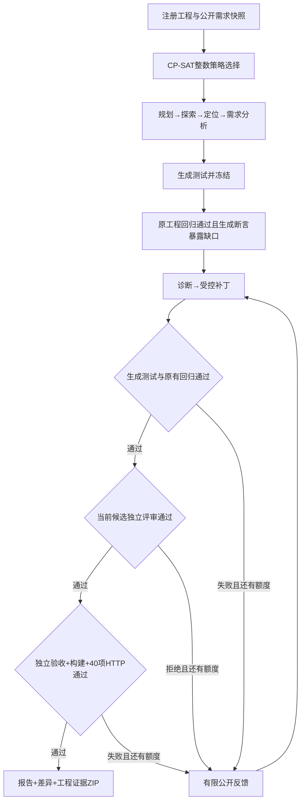

# 九能力自主工程补全

公开版说明：本文中历史 run-id 与 `artifacts/` 路径用于说明本地证据组织方式；这些原始运行产物、模型 captures 及机器相关文件不随公开源码分发。当前源码从固定上游 fixture 发起新运行并产生新的证据。

完整工程入口已经连接真实模型传输、OR-Tools CP-SAT 整数调度、受控补丁工具和确定性验收。当前注册并验证的业务适配器是 Flaskr；函数任务、历史会话结果评测仍保留各自入口。

默认使用本机已登录 Codex CLI 的 ChatGPT OAuth 登录态，请求模型为 `gpt-5.6-sol`。工程不复制 OAuth 凭据，也不要求为这个入口另建 API Key。登录可用只代表具备调用条件；实际推理、失败和用量应查看本次运行的模型轨迹。AgentArts 云端尚未部署，已有客户端/适配器 mock 测试不构成云上运行证据。

## 启动与入口

先按 [README](../README.md) 运行 `scripts/bootstrap.ps1`。它会调用 `scripts/setup-project.ps1`，默认用 Python 3.13 创建/复用 `.venv-flaskr`，安装锁文件中的 17 项固定版本 Flaskr 验证依赖，并检查 Flask、pytest、build。也可单独重跑 setup 脚本修复验证环境。

环境安装不对旧 `experiments/flaskr/candidate` 执行 editable `-e` 安装。pytest worker 显式绑定本次独立 baseline/candidate 的 `flaskr` 导入并保留绑定证据；HTTP 验证使用本次构建解包的 wheel，不借用旧候选的安装结果。已登录的本机 CLI 可直接复用：

```powershell
codex login status
.venv/Scripts/python.exe -m testfix.cli complete-project --project Project/flaskr --provider codex_cli --model gpt-5.6-sol --max-rounds 2 --wall-seconds 4500 --token-limit 800000 --strategy balanced
```

这条命令发起新的模型调用，从注册的原始工程复制独立工作区，生成测试、补丁和评审。它不同于 `evaluate-project` 对已保存候选重新验收，也不同于 `evaluate-session` 读取历史模型输出。

本地控制台的完整工程入口调用 `POST /api/project-runs`；`GET /api/projects` 返回项目、可用 provider 和默认配置。默认预算为 4500 秒、800000 token、一个模型槽和两个 CPU 槽，修复轮数默认为 2，可配置 1–5。`openai`、`ollama` 和 `agentarts` 是另外的真实传输选项，需要相应配置；不可用时明确失败，不自动改用 replay。

## 实际执行链

| 顺序 | 能力 | 执行及产物 |
| --- | --- | --- |
| 1 | plan-workflow | 模型核对目标与完整九能力顺序；整数求解器已先选定合法策略 |
| 2 | explore-repository | 在公开源码索引中返回真实存在的候选路径 |
| 3 | ground-code | 将需求绑定到文件、符号或路由，保存实际文件 SHA-256；允许的新文件只能标为尚不存在 |
| 4 | analyze-requirements | 输出目标、现状、缺口、公开验收标准和假设 |
| 5 | generate-tests | 输出独立 pytest 文件、步骤和需求映射；宿主冻结测试后执行原工程回归与生成测试基线 |
| 6 | diagnose-results | 根据公开失败证据定位原因，限定修复文件范围 |
| 7 | repair-code | 返回绑定当前候选哈希的完整文件内容，由宿主补丁工具实施写入 |
| 8 | review-patch | 独立模型角色检查当前候选，评审必须绑定实际源码哈希 |
| 9 | verify-delivery | 宿主确定性执行独立验收、wheel 构建、真实 HTTP 与 SQLite 重启验证 |

前八项是不同的模型能力和输出结构，第九项不调用大模型。重试时会产生更多模型调用，不能把九项能力解释为固定九次推理或九个模型实例。`pure_python` 继续使用其六项核心能力计划和原有函数执行器。



生成套件必须正常收集，并在原工程上出现功能断言失败；跳过、收集错误或导入绑定错误不算发现缺口。候选公开测试失败或评审拒绝时，不执行独立验收。独立验收失败只向后续模型提供有限结果摘要，不提供验收源码；下一轮修复后必须重新运行公开测试并重新评审新候选。达到轮数、能力调用额度或预算上限后停止。

模型返回严格 JSON 并通过输出 schema 后，如果实际路径、需求 ID、写入范围或版本等语义校验失败，控制器反馈具体原因，允许一次纠正调用。纠正和业务修复共享累计调用额度；不是无限重试。传输或结构错误保留真实错误和调用轨迹，不产生替代答案。

生成测试与补丁在写入前还要通过整组 dry-run 预检：路径、语法、大小、允许范围与候选版本全部通过后才实施写入，预检错误可进入同一有限纠正流程。生成测试的 `files[].path` 必须是 `test_*.py` 或 `conftest.py` 这样的裸文件名，不能带 `generated_tests/` 等目录前缀；宿主负责放入独立目录。纠正不放宽文件范围，也不通过部分先写来绕过整组校验。

## 整数调度与预算

实现位于 [scheduling.py](../testfix/scheduling.py)，完整数学模型见 [ilp-model.md](ilp-model.md)。选择变量是布尔变量，起止时间是整数毫秒；每个必需能力恰选一个策略，并约束依赖、固定单轮顺序、模型/CPU 容量、候选写锁、总声明时长和 token 预算。使用真实 CP-SAT，没有将选择变量放松成连续数，也没有用伪造计划回退。

当前提供 `focused`/`expanded` 策略，差异是配置的输出额度；两者都保留全部审核与验收关卡。`fast` 限定 focused，`thorough` 为模型能力选 expanded，`balanced` 在合法选项中求解。累计声明时长包含模型超时乘允许调用次数，也包含公开测试工具：`generate-tests` 另加 150 秒原工程公开基线，`repair-code` 另加每个业务修复轮次 150 秒候选公开测试，`verify-delivery` 自身包含最终确定性工具额度。默认两轮的计划时长为 4410 秒（73.5 分钟），置于 4500 秒（75 分钟）总预算内，不是承诺一定耗时这么久。

token 预测来自公开输入 UTF-8 字节数约除以 3、配置的每次 12000-token 传输开销及输出额度，再乘允许调用次数。这些是规划输入和估计，不是实测性能或费用。

`OPTIMAL` 表示对声明目标已证明最优，`FEASIBLE` 表示已有合法计划但未证明最优；二者都不能证明工程通过。控制器的求解时间限制是 10 秒与剩余总时间的较小值，给 CPU 忙碌时的真实搜索保留余量；这不保证一定找到解。`INFEASIBLE` 和 `UNKNOWN` 没有可执行计划，不发起模型调用。当前排程是固定顺序的单轮串行模型，资源槽增加不代表已经实现跨项目并行提速。

| 能力 | 单次合同超时 | 累计合同调用上限 |
| --- | --- | --- |
| plan / explore / ground / analyze | 120 秒 | 各 5 次 |
| generate-tests / diagnose / repair / review | 180 秒 | 各 5 次 |
| verify-delivery | 240 秒 | 5 次 |

执行器使用单次合同超时与剩余总墙钟预算中的较小值。计划通常进一步收紧允许调用次数：不随业务轮次重复的模型能力最多预留两次；诊断、修复和评审按轮次及纠正额度预留，均不超过五次；验证按修复轮数预留。基线/候选公开工具调用各有最多 150 秒的执行限额，最终验证工具最多 240 秒，均受剩余总预算限制。

实际 token 账本与 ILP 预测分开：调用前按公开 JSON 的 UTF-8 字节数加输出额度进行保守预留；调用后按 provider 报告的总量，或输入与输出之和计入。缺少用量报告时按预留值记账，`tokens_used` 留空并标记用量不完整；仍保留已有的 `reported_tokens` 和 `accounted_tokens`。失败调用也进入账本。超预算会停止后续调用，不能标为成功。

**Codex CLI 的 output token cap 是提示词软约束，不是服务端硬上限。** CLI 在结束后报告的 token 是传输报告值，不作为独立核验的账单费用。报告保留输入、输出、缓存等 provider 字段；不能把缺失用量写成零，或把估计写成已付费用。

## 验收与受保护边界

注册 Flaskr 合同包含原有 **24 项回归**、独立 **20 项验收**和 **40 项 HTTP 检查**。生成测试的数量由本次模型输出和实际收集结果决定，不固定写成历史实验的数量。基线和候选必须收集完全相同、无重复的测试身份；运行证据还要确认 `flaskr` 实际导入自对应工作区。

原始源码、原有测试、生成后冻结的测试和独立验收目录均有哈希封印。只有 `repair-code` 的宿主补丁工具可写允许的业务文件；模型输出本身不是文件写入权限。补丁必须引用当前候选 SHA-256，评审必须引用修改后的实际候选 SHA-256；旧版本批准不能转移到新补丁。每次调用还核对 Skill 目录快照与前序能力产物哈希。

交付要求 wheel 构建成功，并从构建产物启动应用进行实际 HTTP 请求，验证注册登录、授权、详情、搜索、分页、Unicode、超大页码、转义与数据库跨进程重启。控制器核对 40 个固定且唯一的检查名称、逐项通过状态与汇总数量，少一项也不能仅凭 `successful=true` 通过。模型自评和求解器状态均不能覆盖失败关卡。

这些控制面向已检查的 Flaskr 工程。Flaskr adapter 会执行真实 Python、Flask 和 SQLite，不是任意语言工程的通用执行器，也不是抵御恶意仓库的操作系统安全沙箱。模型 CLI 在独立临时目录接收公开 JSON，禁用命令等工具并使用只读模式；这不构成操作系统层面的文件读取隔离证明。

## 运行证据与交付

每次运行写入 `artifacts/<run-id>/`。以该次 `report.json` 的状态、逐项证据和哈希为准；文档不预先记录尚未结束运行的成功结论或生成数量。

| 路径 | 内容 |
| --- | --- |
| `report.json` / `report.md` | 实际状态、整数计划、模型调用、预算账本、测试与交付判定 |
| `capabilities/<skill-id>/attempt-*.json` | 来源版本、候选哈希、前序产物哈希和能力输出 |
| `model_calls/<序号>-<skill-id>/` | `request.json`、`result.json`、`trace.json`，记录模型、用量与错误 |
| `workspace/` | 原始与候选快照、冻结生成测试、受保护的独立验收 |
| `tool_calls/` / `delivery/` | pytest、导入绑定、构建与 HTTP 的实际执行证据 |
| `patch.diff` | 相对原始工程的代码差异 |
| `completed-project.zip` | 只有最终通过时生成的候选工程、验证文件和能力证据 |

网页通过 `GET /api/runs/<run-id>` 查看状态，通过 `GET /api/runs/<run-id>/report?format=json` 下载报告，通过 `GET /api/project-runs/<run-id>/download` 下载已完成工程。下载接口复核归档哈希，失败、拒绝或预算耗尽的运行不提供成功交付包。

请求模型名和服务回报模型名分别记录。如果 CLI 只确认了请求参数而未回报实际模型，轨迹使用 `requested_cli_flag_only`；不会补写服务确认。历史会话 captures 与复验 manifests 不随公开源码发布；当前入口从原始 fixture 创建新的自主运行。

## 本次真实运行记录

运行 `1a500f9521c141168613504e1c57d352` 已核对最终报告与交付归档：状态 `completed`，验收工程 1/1，九项能力均 `completed`，一轮补丁完成，实际耗时 **441.452 秒**，全部 verdict 为真。

| 验证 | 原始工程 | 最终候选 |
| --- | --- | --- |
| 本次模型生成测试 | 0/10 | 10/10 |
| 原有回归 | 24/24 | 24/24 |
| 独立验收 | 0/20 | 20/20 |
| wheel 构建 | — | 1/1 |
| 实际 HTTP 检查 | — | 40/40 |

40 项 HTTP 证据包含 SQLite 数据及账户跨进程重启保持。候选源码哈希与独立评审哈希一致，保护文件未变、成对测试和全部交付检查通过。八次真实 Codex CLI 请求均明确设置 `gpt-5.6-sol`，服务没有回报实际模型名；八次 `actual_model` 均为 `null`，`model_evidence` 均为 `requested_cli_flag_only`。provider 报告总量及执行账本均为 **198161 token**，这是传输报告值，不是独立核验的账单证明。

- 最终报告：`artifacts/1a500f9521c141168613504e1c57d352/report.json`。
- 交付 ZIP：`artifacts/1a500f9521c141168613504e1c57d352/completed-project.zip`。
- 候选/评审 SHA-256：`3e21525c240266d1f52184f1c14a4c9ca3bdc51665087b4ed940bd762443e492`。
- ZIP SHA-256：`fad05316a340c1058584310295d84b5a3bc8383893b81cdf6afcc1779b530a15`，已按归档实际字节复核。

该结果属于本次注册 Flaskr 合同的一次真实自主运行，生成数量为这一次实际收集到的 10 项，不固定为今后运行数量，也不外推为任意工程或全部输入正确。

### 保留的失败执行

运行 `0f4b56e1ccc04061998bb26bc604bdff` 的报告保存在 `artifacts/0f4b56e1ccc04061998bb26bc604bdff/report.json`，实际状态为 `failed`、验收数为 0。前四项模型能力完成后，测试生成输出使用了 `generated_tests/conftest.py`，违反宿主的裸文件名约束；未实施生成测试写入，也未进入业务补丁、评审或验收。该失败被保留，没有改记为通过。

针对这个边界，控制器随后将生成测试及补丁的整组 dry-run 预检接入有限纠正，并明确裸文件名要求。上面的完成记录来自新的独立 run-id；失败与成功分别保留，修复代码和单元测试通过本身不代替真实模型验收。

代码与回归入口：[project_workflow.py](../testfix/project_workflow.py)、[project_models.py](../testfix/project_models.py)、[project_tools.py](../testfix/project_tools.py)、[test_project_workflow.py](../tests/test_project_workflow.py)。边界单元测试使用明确的注入 fixture，不作为真实模型或业务工程的成功证据。

## 可复现的完整源码分发

`scripts/package_source.py` 生成 `artifacts/release-v0.2.0/testfix-agent-v0.2.0-source.zip`，包含核心代码、`web/`、已固定的工程 fixture、脚本和文档；包内 `SOURCE-MANIFEST.json` 与包外 `.manifest.json` 保留文件/归档哈希。它不打包 `artifacts/`、本机虚拟环境或 `.env` 凭据文件，保留可填写的 `.env.example`。

完整部署使用解压后的源码根目录运行 bootstrap/setup/start。v0.2.0 wheel 只交付核心库及 Skill 文件，不包含完整网页与实验 fixture；仅安装 wheel 不能独立复现完整 `serve` 与注册 Flaskr 自主流程。
