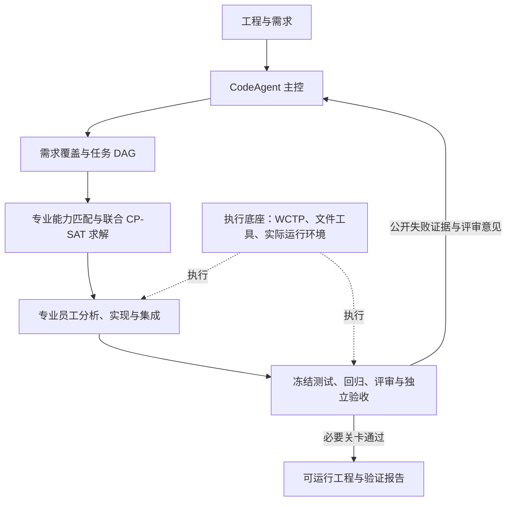

# CodeAgent、专业员工和自动化测试

主架构分为三部分：CodeAgent 主控、多 Agent 生成与补全、自动化测试。主控维护需求和任务依赖、调用调度器并接收失败反馈；专业员工在分配的文件中分析或实现；测试模块设计并冻结用例，由宿主和 WCTP 实际执行，再进行独立评审、验收、构建及运行检查。

九项能力是必要的工程处理与质量流程，不等于九个长期驻留的员工实例。员工实例是一次具体任务的执行者，可以加载多个必要的专业 Skill。算法、任务 DAG 和执行环境分别属于工具、数据和底座，不能与员工并列。

输入经过材料登记、工程与环境识别、需求/代码分析、需求合同与测试生成、原工程执行，再进入工作图与员工实现。修复后须重新执行冻结测试、检查回归、独立评审并验收。已有适配器的质量门槛与受保护测试保持不变；未知工程、仅有二进制安装包或缺少实际执行环境时不能宣称已完成源码补全。

## 联合分配

`testfix/team_assignment.py` 根据宿主从源码与注册需求得到的专业匹配，生成候选员工实例与策略。每个任务恰好选择一个可执行的员工/策略，所有未完成任务必须保留。约束包含任务依赖、员工实例互斥、模型槽位、同文件写冲突、剩余声明时间与 Token 预算；已经开始的员工身份和策略固定，已完成任务不会重新分配。

优化依次考虑总完成时间、按出度/声明关键路径等排序的等待、声明成本与专业匹配。耗时、Token 和匹配惩罚是宿主配置的估计，不是学习出的成功率或实际性能保证。后续优化阶段超时，只能保留已经得到的可行解，不伪称最优。

控制器入口直接使用联合模型判断可行性，不再由旧的固定时序估计提前否决策略选择。每次工具批次结束后重新求解，在途任务扣除宿主已记账 Token 和实际经过时间，继续固定原员工身份及策略。实际派工仅采用求解结果中的就绪任务和选定员工；预测时间不用于睡眠等待。模型决定并行交给 WCTP；工具与提交在屏障后由宿主顺序处理，继续检查文件归属、读集、版本与冻结资源。实际全局时间/Token 预算始终有效。独立验收、测试质量和评审不由调度目标替代。

任务数量不再固定为四项：默认 32，可通过 `TESTFIX_MAX_WORK_ITEMS` 配置为 1–256。增大任务数量不会增大模型槽位、时间或 Token 预算。每位员工按任务、轮次和 Skill 分别计算动作额度，避免多个员工错误共用五次调用额度。核心能力调用仍保留独立限额。计划中的初始阶段策略预算、任务联合分配估计与实际资源记账分别记录。

每轮保存 `task_graph.feature_groups` 和 `task_graph.tasks`，包含需求、职责、文件、依赖、验收描述、状态及回执；`allocation_plans` 记录每次求解、预算及可派工任务；`employees` 绑定专业、员工编号、策略和分配编号；`dispatches`、`batches`、`messages` 保存实际派工、WCTP 批次及交接。

专业目录包括软件、前端、JS/TS、Three.js、后端、数据库、集成、MCU、MPU 和协议。只有本任务涉及且执行条件满足的专业才会参与。专业目录不等于已经具备所有语言和设备的通用构建能力；工程适配器仍独立检查运行环境和必要门槛。

## 可视化

三维视图保留三个主模块，切换查看主控工具、补全员工或测试能力。员工使用专业名称而不是泛化编号；流程能力用扁平虚线样式，执行器单独画成底座。点击可查看任务、需求、前置条件、文件、员工、策略、分配编号与最近反馈。不涉及的专业列为未激活。

灰色虚线分别表示包含关系和计划依赖，实际交接绑定宿主事件；相邻流程阶段不再被画成已经发生的 Agent 通信。历史记录没有联合分配证据时明确说明，不用新算法解释旧记录。支持实时轮询、事件回放、暂停、旋转缩放与窄屏；断线和渲染失败保留文本证据。

## 本轮证据

真实运行 `8c66a09e7c8143b8a04d921559f9fdb7` 使用用户上传的 TaskBoard。复用 `1cccaba6d5a24220bb53da385f7e2ad0` 中已核验的 5 项公开分析/测试输出，新增 13 次真实模型调用，约 192 秒完成。请求 `gpt-5.6-sol`，服务未回报实际模型名称。

两项分析任务分配到 `database#1` 和 `database#2` 并行执行；存储修复交给 `database#1`，接口任务交给 `software#1`，均采用 `standard` 策略。共 9 次联合求解，实际批次峰值并发为 2。员工编号与模型调用上下文相符，工具回执 SHA-256 已复核。

结果：回归 6/6、冻结生成测试 10/10、独立验收 12/12、实际 HTTP/SQLite 重启与循环检查 37/37，回归破坏 0。这是一个已登记 Python 工程的功能验证，不是对通用仓库成功率或调度性能提升的证明。

证据在 `artifacts/architecture-change/experiment-evidence.json`、`ui/validation.json`、原始运行目录及同目录代码审查快照。浏览器验证本身不提交模型任务；实时追加与断线恢复使用明确的受控快照测试。

独立审查发现并修正了在途额度重复计入及旧固定计划提前否决两个边界问题。针对 24,000 Token 员工读取消耗 100 后仍可继续，以及 44,000 预算选择 38,400 的 focused/standard 组合，新增了回归检查。真实模型实验使用正常预算，这些窄预算边界由专门执行与求解回归验证。
